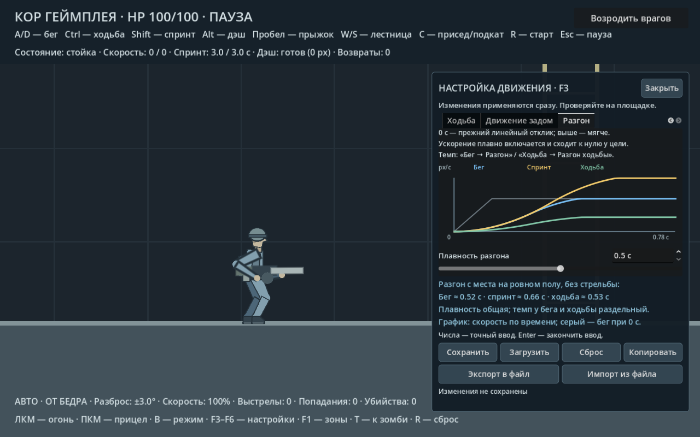

# Плавность разгона

**F3 → «Разгон» → «Плавность разгона»** управляет плавным включением и спадом
ускорения. Диапазон **0–1 с**, шаг 0,01 с, по умолчанию **0,15 с**.
0 с возвращает прежний линейный набор скорости с мгновенным включением
ускорения; большие значения делают начало и достижение максимума мягче.

Темп остаётся отдельной настройкой: «Бег → Разгон» применяется к бегу,
спринту и приседу; «Ходьба → Разгон ходьбы» — к ходьбе на Ctrl.
Плавность работает на всём участке разгона, а не добавляет задержку перед
началом движения. Скорость начинает увеличиваться сразу после ввода.
Для отчётливо мягкого отклика можно поставить плавность **0,3–0,5 с**,
затем подобрать темп в соответствующей вкладке.

График показывает скорость по времени при разгоне с места на ровном полу,
без стрельбы: синий — бег, жёлтый — спринт, зелёный — ходьба.
Серый — сравнение с бегом при плавности 0 с. Ползунок и точный ввод обновляют
график сразу; настройки доступны и на паузе.

## Поведение

Контроллер постепенно меняет ускорение до заданного темпа и уменьшает его
перед достижением целевой скорости. Скорость доходит до точного максимума,
не превышая его. При смене цели — например, из-за стрельбы, перехода на Ctrl
или изменения наклона поверхности — сохраняется текущее ускорение;
непрерывные изменения цели не запускают разгон заново каждый кадр.

Плавность распространяется и на движение задом. Штраф заднего хода,
замедление от стрельбы и склоны определяют конечную скорость, а плавность —
путь её достижения. В воздухе действует отдельное управление;
прыжок наследует фактическую скорость отталкивания. Дэш и подкат сохраняют
свои отдельные импульсы. Отпускание движения использует прежний параметр
торможения. Состояние ускорения очищается при прыжке, дэше, подкате,
захвате лестницы, отбрасывании и перезапуске.

Новая настройка `acceleration_smoothing` сохраняется в профиле F3 и общем
JSON из 121 значения. Старые файлы получают значение 0,15 с по умолчанию.
Кнопка «Сброс» также возвращает 0,15 с.

Проверки: `tests/acceleration_smoke.gd`; сохранение и импорт —
`tests/settings_file_smoke.gd`; движение по склонам — `tests/slopes_smoke.gd`.
Скриншоты и базовый JSON — `tools/capture_acceleration.gd`.
