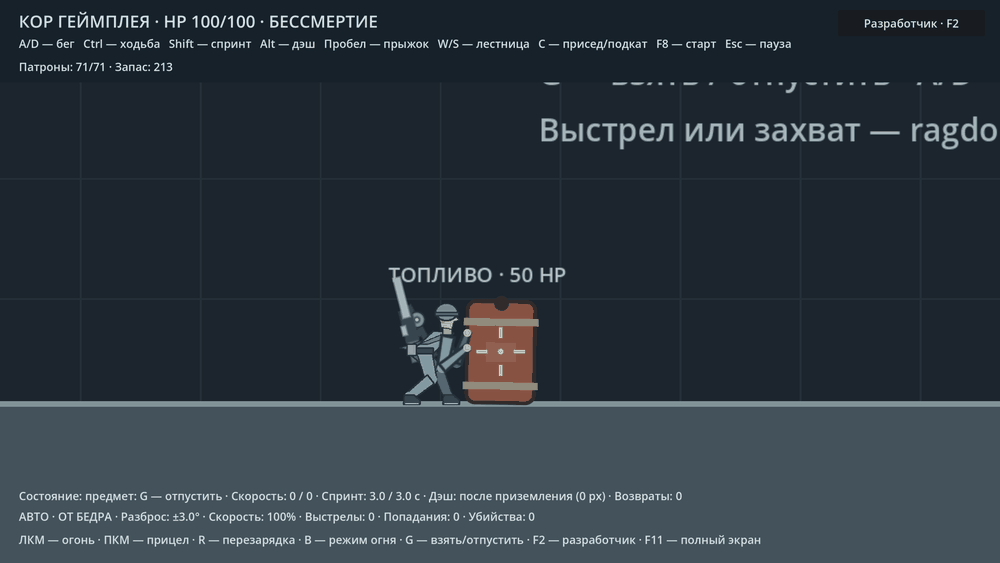
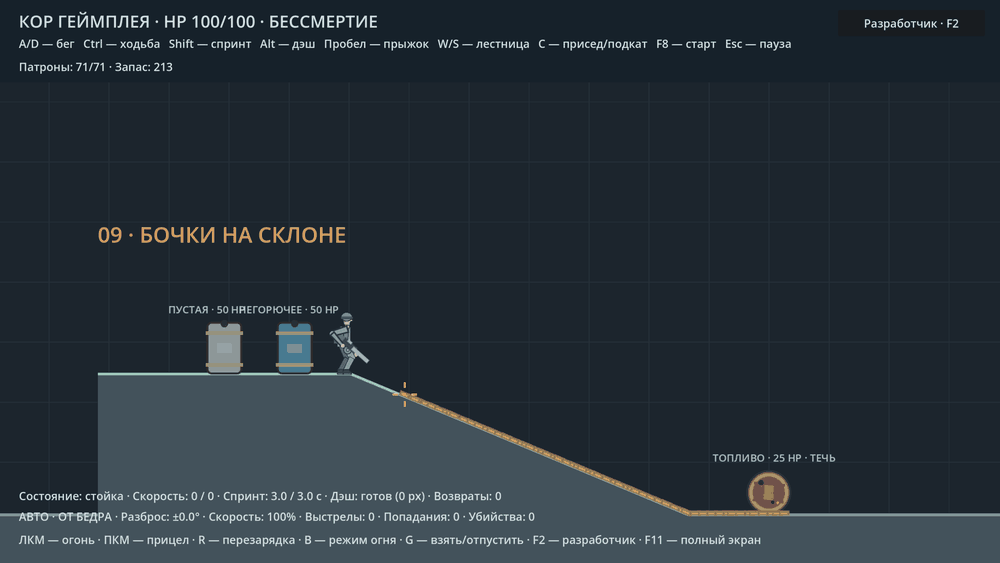

# Бочки, топливо и перекатывание

В полигоне восемь бочек: пять в зоне 08 (две взрывные, топливная, пустая,
негорючая) и три на верхней площадке склона в зоне 09 (топливная, пустая,
негорючая). Старые зоны и старт сохранены;
левая граница расширена до −3500 px. Переходы — **F2 → Физика → Бочки**.

| Цвет | Содержимое | Пули и огонь |
|---|---|---|
| Красный | Взрывная | Взрывается после потери HP от пуль, не оставляет топливо |
| Коричневый | Топливо | Пробивается, течёт, взрывается от огня или взрывного урона |
| Серый | Пустая | Разрушается без горючих луж и детонации |
| Синий | Негорючее содержимое | Разрушается без горючих луж и детонации |

У всех одна геометрия, масса 10 кг, материал и правила физики. Различие
силуэтов между видами отсутствует: отличаются цветом. Подпись — диагностическая.

**Взрывная и топливная — два разных типа.** Для размещения в редакторе
используются отдельные сцены: `scenes/core/explosive_barrel.tscn` и
`scenes/core/fuel_barrel.tscn`. Взрывная по умолчанию выдерживает один выстрел
на 25 HP и взрывается после второго: прочность 50 HP, запал 0,15 с.
Её взрыв не зависит от переключателей утечки и горения топлива.
Оба типа поддерживают огонь и цепную детонацию; пули выпускают топливо
только из топливной. Пустая и негорючая не детонируют.

## G и анимации

Подойти вплотную и нажать **G**. Герой берётся двумя руками, укладывает
стоящую бочку от себя за 0,55 с; наклон и движение кистей синхронизированы.
**A/D** перекатывают бочку в обе стороны со скоростью до 120 px/с.
Остановка сохраняет захват. Повторное **G** освобождает руки; бочка остаётся
самостоятельным физическим телом, сохраняет импульс и подчиняется гравитации.
Чтобы оставить её в покое на ровном полу, сначала остановить движение.

Для укладки и перекатывания запечены отдельные **8 кадров** тела;
сегментные руки следуют точкам хвата на оболочке. Автомат остаётся за спиной.
Обе стороны зеркальны. Пока руки заняты, стрельба и остальные действия
ограничены существующим захватом. Запал, разрушение, смерть, сброс уровня
и потеря контакта безопасно отпускают предмет.

Стоящая бочка имеет округлую вертикальную коллизию; уложенная — круглую
для физического качения. После естественного опрокидывания коллизия тоже
переходит к качению. Перемещение уложенной бочки даёт центральный импульс;
вращение возникает от физического контакта с полом. После отпускания
никакой кинематической фиксации не остаётся.

## Утечка и поджиг

Первое попадание по умолчанию пробивает топливную бочку. Порог можно
выставить в **1 или 2 попадания**. Последующие пули продолжают повреждать
оболочку и не заменяют проверку отдельного поджига. Даже при исчерпании
HP корпус остаётся пробитым баком, который можно перекатывать и поджечь.
Прямой вызов общего урона/взрыв и API `ignite_from_fire()` могут инициировать запал.

Топливо капает на реальные поверхности; каждые 5 px пройденного пути
проверяется земля. След следует наклону, не соединяет через воздух разные
платформы. При скорости ниже 22 px/с лужа разрастается вдоль опорной поверхности
до заданной полуширины. На быстром участке остаётся узкая связная полоса.
Ни лужи, ни след не имеют таймера исчезновения и не мешают движению.

По умолчанию **запас 0 = без ограничения**, чтобы след сохранялся на всём
пути. Положительный запас включает расход по 4 ед./с до опустошения.
Отключение и повторное включение утечки не дорисовывают пройденный за это время путь.

Пуля проверяет видимый участок своей реальной траектории до первой стены.
Выстрел в топливо поджигает место контакта, затем фронт идёт по соседним
соединённым участкам со скоростью **85 px/с**, в обе стороны от точки поджига.
Несвязанные лужи не загораются одновременно. Огонь покрывает всю связанную
лужу; достигнув корпуса топливной бочки, инициирует обычный запал и взрыв.
Пустая и негорючая бочки от пламени не детонируют.

Отдельный участок горит **14 с**, после чего остаётся постоянный тёмный
след. Новая порция топлива может снова гореть. Горение наносит 15 HP/с
в своей области с периодическими тиками, с учётом бессмертия и правил
здоровья игрока. Перекрывающиеся участки не умножают урон одной цели.

## Удар бочкой

Считается приближающаяся скорость в точке **реального физического контакта**.
Ни медленное касание, ни покоящаяся бочка не наносят урон. Порог — 90 px/с;
урон — скорость × 0,08. От 220 px/с удар также сбивает врага/героя на 1,5 с.
Персонаж, который держит бочку, исключается из её контактного урона.
Повторный удар по той же цели ограничен интервалом 0,75 с.

Для врагов используется существующее сбивание. Герой падает в низкую позу,
получает физический толчок, временно не может стрелять/делать дэш и затем
встаёт, если сверху свободно. Бессмертие защищает HP, но не отменяет физику.

## Настройки и восстановление

**F2 → Физика → Бочки**: прежние HP и запал, независимые тумблеры утечки,
горения и столкновений; порог попаданий, запас и расход топлива, полуширина
лужи, скорость фронта, длительность/урон/высота огня, время укладки и скорость
перекатывания, пороги урона/сбивания, множитель урона, время на земле и интервал ударов.
Все числовые поля имеют ползунки и точный ввод. Они входят в прежний CFG
и JSON версии 1; старые профили получают новые значения по умолчанию.
Всего сохраняются **311 значения**, из них **98** в разделе `ragdoll`
(включая новые подвесные грузы).

F7 сохраняет топливо и следы. F8 и «Восстановить бочки» очищают топливо,
огонь, обломки бочек и возвращают все виды к исходным положениям.
Пауза останавливает утечку, физику, огонь, запалы и восстановление героя.

## Проверка

- `tests/barrel_types_smoke.gd` — отдельные сцены, разные реакции на одинаковые
  попадания, цвет, физика, независимость от топливных переключателей и сброс.
- `tests/barrel_fuel_smoke.gd`: **36/36** — реальные пули, порог, лужи,
  связный фронт до взрыва, постоянные следы, естественное падение/качение
  всех видов на склоне, физические удары по врагу и игроку, восстановление.
- `tests/barrel_grab_smoke.gd`: **70/70** — четыре вида и обе стороны,
  G, восемь кадров, обе кисти, перекатывание вперёд/назад, отпускание.
- `tests/barrel_fuel_edges_smoke.gd`: **15/15** — стены, вся связанная лужа,
  независимые тумблеры, урон без умножения, бессмертие, пауза и F7.
- Прежние проверки: взрыв **35/35**, его настройки **19/19**, захват
  ящика/манекена **79/79**, стрельба **41/41**, общий JSON **88/88**.

Код: `scripts/core/explosive_barrel.gd`, `scripts/core/fuel_field.gd`.
Захват кадров: `tools/capture_barrel_system.gd`; GIF: `tools/make_barrel_previews.py`.
