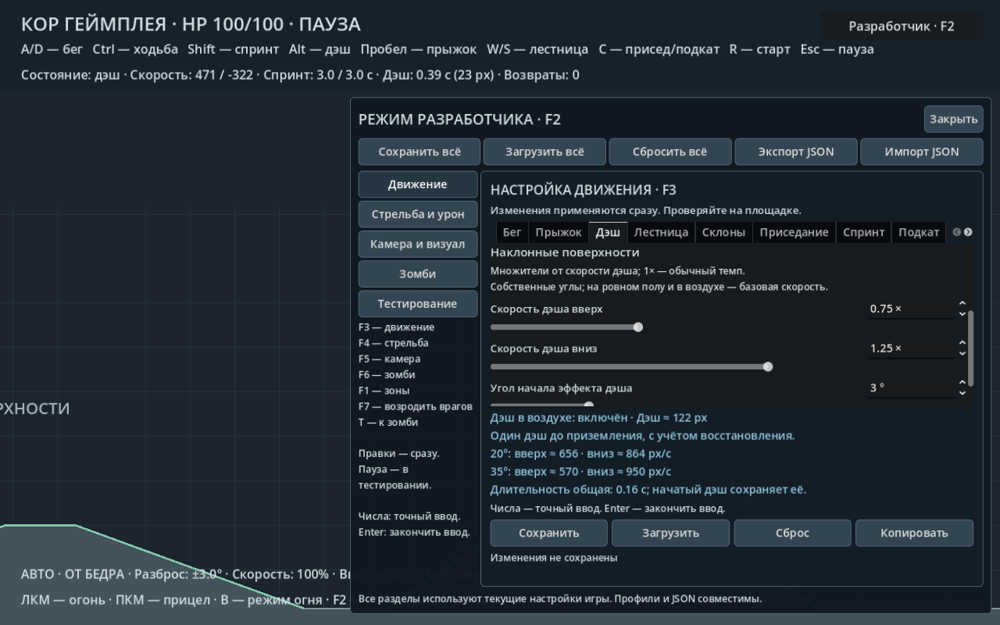

# Дэш героя на наклонных поверхностях

В **F3 → «Дэш» → «Наклонные поверхности»** находятся четыре независимых настройки:

| Настройка | По умолчанию | Диапазон |
|---|---:|---:|
| Скорость дэша вверх | 1× | 0,2–2× |
| Скорость дэша вниз | 1× | 0,2–2× |
| Угол начала эффекта дэша | 3° | 0–15° |
| Угол полного эффекта дэша | 35° | 16–45° |

Множители относятся к базовой скорости из вкладки «Дэш». Значение 1×
сохраняет текущий темп, меньше 1× замедляет, больше 1× ускоряет.
Например, при базовой скорости 760 px/с и множителях 0,75 / 1,25 на
уклоне 35° получится 570 px/с вверх и 950 px/с вниз по поверхности.

Эффект плавно возрастает между двумя углами. Для ходьбы и спринта
продолжают действовать их собственные регуляторы из вкладки «Склоны».
На ровном полу и в воздухе дэш использует базовую скорость.

Направление подъёма/спуска определяется по направлению самого дэша,
зафиксированному при запуске. Оно не зависит от прицеливания или
нажатия противоположной клавиши во время рывка. Скорость пересчитывается
по текущей поверхности каждый физический такт, поэтому при переходе
через вершину применяется подходящий множитель. При максимальных
скоростях увеличивается расстояние удержания контакта на время такта
наземного дэша, чтобы герой следовал спуску после вершины.

Длительность и восстановление дэша остаются общими. Настройка скорости
меняет дальность. Стены блокируют дэш, враги по-прежнему пропускают героя.
Редактирование множителей и углов действует сразу, включая активный дэш.

Все четыре значения входят в сохранение F3 и общий JSON экспорта/импорта.
Старые профили получают нейтральные множители 1× и углы 3° / 35°.
Для отключения влияния уклона установите оба множителя в 1×.

Проверки: `tests/dash_slopes_smoke.gd`, `tests/slopes_smoke.gd`,
`tests/settings_file_smoke.gd`. Скриншот и базовый JSON воспроизводятся
через `tools/capture_dash_slopes.gd`.
