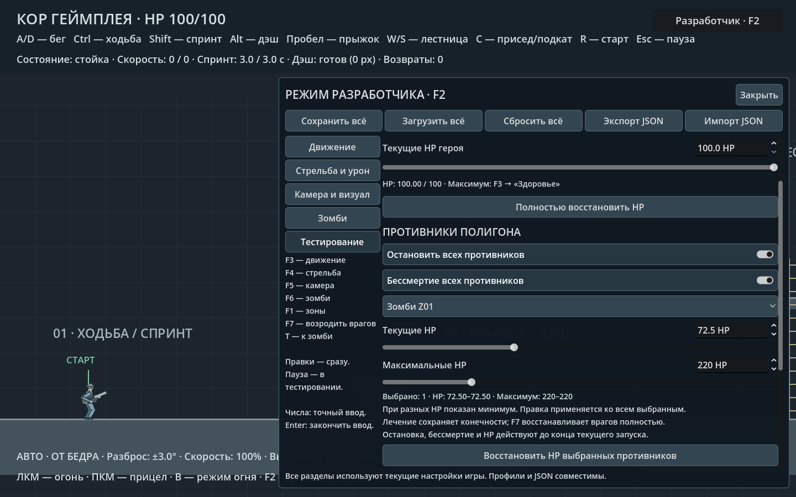
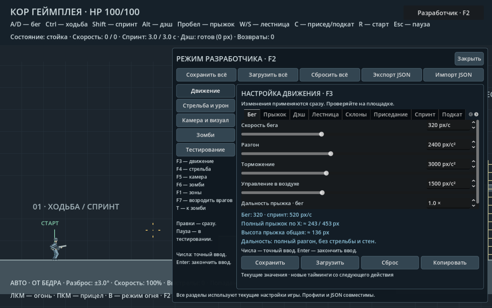
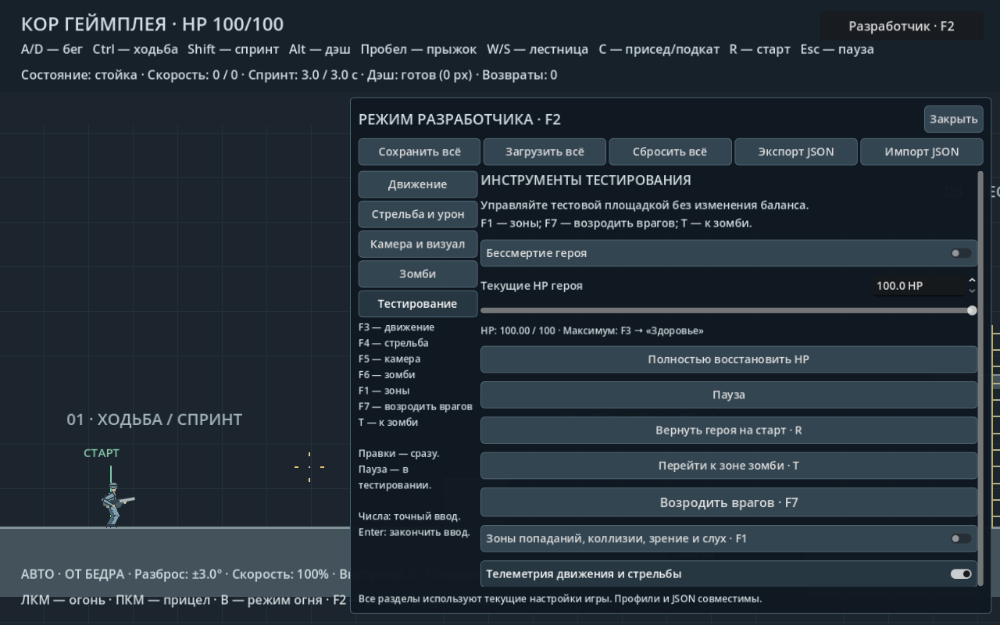

# Режим разработчика

**F2** или кнопка «Разработчик · F2» открывает единое окно настройки игры.
Игра запускается с выключенным режимом разработчика. Окно не ставит мир
на паузу: баланс можно править и сразу проверять движением и стрельбой вне панели.
При числовом вводе управление героем блокируется; Enter завершает ввод.
Закрытие окна подтверждает незавершённое число и сохраняет текущий баланс
в памяти, но не записывает его на диск автоматически.

## Разделы

| Раздел | Что находится внутри |
|---|---|
| Движение | Все 12 вкладок героя: бег, ходьба, спринт, прыжок, дэш, лестница, приседание, подкат, сбивание, склоны, движение задом, плавность разгона и максимальное здоровье |
| Стрельба и урон | Оружие, одиночный/автоматический режим, разброс, прицеливание, отдача, камера при выстреле, звуки, зональный урон и прочность конечностей |
| Камера и визуал | Приближение, смещение, упреждение и плавность камеры, края уровня, интенсивность/радиус/порог блюра и сглаживание спрайта |
| Зомби | Все семь вкладок и их переключатели: зрение, слух, движение, бой, ползание, сбрасывание и реакция на попадания |
| Тестирование | Бессмертие и HP героя; остановка, бессмертие и HP противников; пауза/продолжение, возврат героя на старт, переход к зоне зомби, возрождение врагов, зоны попаданий/коллизии/зрение/слух и телеметрия |

Все **134 параметра баланса** используют игровые ресурсы и диапазоны.
Дэш и его параметры склонов находятся в одной вкладке «Дэш». Движение,
урон и сбивание подкатом находятся в одной вкладке «Подкат» с общим
прокручиваемым списком. Все прежние ключи профиля и JSON сохранены.
Старые профили CFG и файлы JSON работают без конвертации. Клавиши F3–F6
остались быстрым открытием соответствующего раздела в общем окне.
Повторное нажатие клавиши открытого раздела закрывает режим разработчика.
F1 включает/выключает зоны независимо от окна разработчика. Закрытие окна
не скрывает включённые зоны; повторный F1 отключает их. T только переносит
героя к зомби, сохраняя открытый раздел и состояние окна. F7 возрождает
всех врагов без перемещения или лечения героя и без сброса статистики.
Все три клавиши работают и на паузе, но блокируются при числовом вводе
и в модальном файловом окне. Удержание клавиш не повторяет действие.
R сохраняет
функцию возврата на старт. B остаётся обычным переключением режима огня.

## Профили и перенос

Вверху окна находятся общие действия:

- **Сохранить всё** — записать все четыре профиля, включая ещё вводимое число.
- **Загрузить всё** — восстановить существующие профили. При ошибке чтения
  какого-либо файла ни один раздел не меняется; отсутствующий старый профиль
  оставляет текущие параметры этого раздела без изменений.
- **Сбросить всё** — восстановить базовые настройки проекта во всех разделах.
  Сохранённые файлы остаются прежними до нажатия «Сохранить всё».
- **Экспорт JSON / Импорт JSON** — прежний перенос всех настроек одним файлом.
  Файловое окно останавливает мир и после закрытия возвращает прежнюю паузу.

Кнопки «Сохранить», «Загрузить», «Сброс» и «Копировать» внизу страницы
относятся только к выбранному разделу. Ошибка сохранения общего набора
показывает названия разделов, которые не удалось записать.

## Здоровье героя

**F2 → «Тестирование»**: «Бессмертие героя», ползунок/точный ввод текущих HP
и «Полностью восстановить HP». Они действуют сразу и на паузе.
Бессмертие блокирует урон ближних атак и сбрасывания, но оставляет физический
толчок. При закрытии окна оно продолжает работать, что отмечается в HUD.
Возврат на старт и переход к зомби сохраняют переключатель в текущей сессии.
Следующий запуск начинает игру без бессмертия; этот флаг и текущие HP
не записываются в профили или балансировочный JSON.

**F3 → «Здоровье»** настраивает максимальный запас: **1–1000 HP**, базовое
значение **100 HP**. Это параметр баланса `movement.max_health`; он сохраняется
в профиле и JSON. Старые файлы без ключа получают 100 HP. Уменьшение максимума
ограничивает текущие HP сразу; увеличение не лечит. Возрождение заполняет
запас до максимума, HUD отображает текущее и максимальное здоровье.

Ручные 0 HP позволяют проверить смерть, в том числе при включённом бессмертии.
Положительное значение или полное лечение восстанавливает героя на месте
без сброса врагов, баланса и статистики. Включение бессмертия погибшему герою
также восстанавливает его на месте с полным запасом. Неверные числа отвергаются,
допустимые значения ограничены диапазоном 0–максимум.

Зоны остаются видимыми до отключения через F1 или переключатель.
Телеметрия видна только при открытом окне разработчика. Их переключатели
независимы. Закрытие режима не снимает поставленную паузу;
F2 и настройки работают и на паузе. Выбор отладки сохраняется до конца
текущего запуска, а следующий запуск начинает игру без отладочных экранов.
Возрождение врагов не переносит героя и не меняет баланс.
Клики по навигации, общим действиям и инструментам не вызывают выстрел.

## Противники полигона

**F2 → «Тестирование» → «Противники полигона»**:

- **Остановить всех противников** замораживает три мишени и зомби: движение,
  гравитацию, атаки, сбрасывание, таймеры, анимации и оторванные части.
  Игрок и пули продолжают работать. Звук и попадание не разворачивают
  остановленного зомби. Выключение продолжает приостановленные действия.
- **Бессмертие всех противников** блокирует потерю HP от урона, сохраняя
  попадания, отстрел конечностей и обычные физические реакции. Включение
  оживляет погибших на месте; падение бессмертного зомби за нижнюю границу
  возвращает его к исходной позиции.
- Список **«HP: все противники»** выбирает всех либо отдельную мишень/зомби.
  Текущие HP задаются ползунком или числом от 0 до максимума. Максимум:
  **1–1000 HP**, исходно 100. Повышение максимума не лечит, снижение
  ограничивает текущие HP. При разных значениях группы показан минимум
  и диапазон; правка применяется ко всем выбранным.
- **Восстановить HP выбранных противников** лечит до их максимума и
  оживляет на месте, сохраняя потерянные конечности и счётчики попаданий.
  **F7** полностью восстанавливает врагов, включая конечности и ИИ.

Ручные 0 HP позволяют проверить смерть даже при бессмертии. Положительное
значение возвращает коллизии и зоны попаданий. Управление работает на
паузе; ввод чисел блокирует игровые клавиши. Переключение выбранного врага
подтверждает незавершённое число для прежнего выбора.
Все эти инструменты действуют до конца текущего запуска, остаются активны
после закрытия окна, F7 и R. Они не меняют профили баланса и JSON;
новый запуск начинает с обычных 100 HP, без остановки и бессмертия врагов.
Над противниками показаны текущие/максимальные HP, `∞` и `СТОП` при
соответствующих активных переключателях.



## Проверка

`tests/developer_mode_smoke.gd`: **71 проверка** обычного старта, всех 27
внутренних вкладок и их размеров, общих операций и отдельных профилей,
незавершённого числового ввода в каждом разделе, паузы, тестовых инструментов,
сохранения баланса между запусками, ошибок чтения/записи, JSON, модального
диалога и подавления выстрелов при работе с интерфейсом.
`tests/player_health_smoke.gd`: **35 проверок** реальных атак и сбрасывания,
бессмертия, текущих/максимальных HP, лечения, смерти и восстановления на месте,
паузы, числового ввода, HUD, профилей, JSON и старых файлов.
`tests/developer_hotkeys_smoke.gd`: **22 проверки** физических клавиш T/F1/F7,
независимого отображения зон, трёх способов закрытия окна, возрождения врагов
без сброса героя и баланса, паузы, открытого раздела, повтора клавиш,
числового ввода, файлового диалога и чистого нового запуска.
`tests/enemy_tools_smoke.gd`: **39 проверок** общих и индивидуальных HP,
максимума и лечения, бессмертия, отстрела конечностей, остановки реального
замаха/сбивания/падения/оторванных частей, движения и стрельбы игрока, настоящих
попаданий, возобновления таймеров, паузы, числового ввода, смены цели,
возрождения и немедленного совпадения зон попаданий с позой, профилей,
JSON и нового запуска.

```sh
/Applications/Godot.app/Contents/MacOS/Godot --headless --fixed-fps 60 --path . -s tests/developer_mode_smoke.gd
```

`tools/capture_developer_mode.gd` создаёт снимок обычного режима
`docs/core/developer_mode_off.png` и пяти разделов `developer_mode_0..4.png`.




