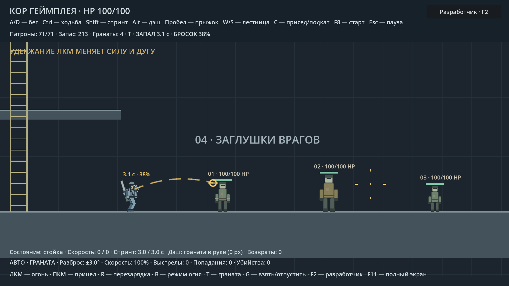
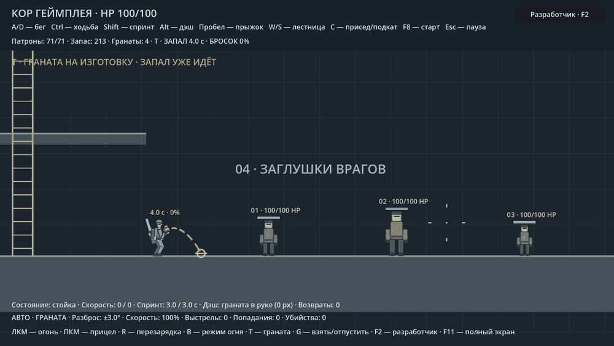
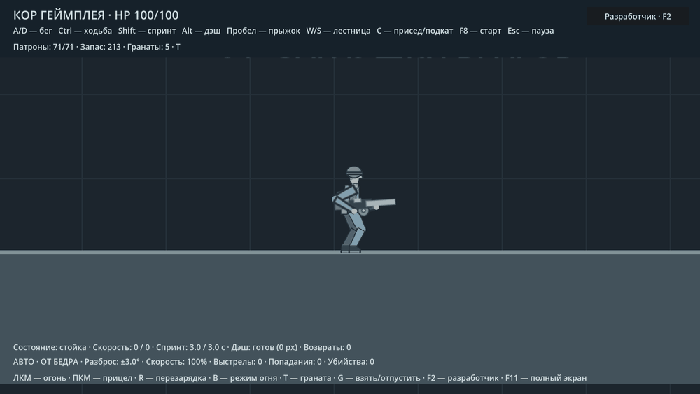
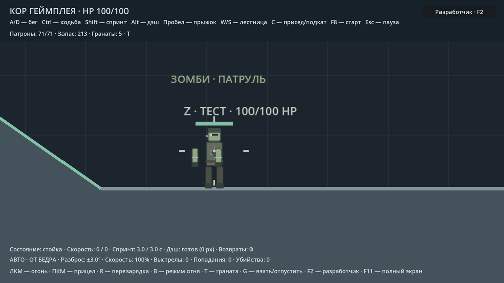

# Гранаты и ударная волна

**T** достаёт одну гранату и убирает автомат за спину. До нажатия **ЛКМ**
запал не идёт: можно держать гранату наготове без ограничения времени.
Повторное **T** убирает её, возвращает в запас и снова достаёт автомат.
Появляются дуга, точка первого столкновения и подсказка броска.
Обе руки переходят в позу подготовки; бросок сопровождается движением руки.
Прицел задаёт направление, включая бросок строго вверх или под ноги.

Нажатие **ЛКМ** запускает запал и показывает оставшееся время и силу броска.
Нажмите и отпустите **ЛКМ** для слабого броска. Удержание повышает скорость
до максимума за настраиваемое время; дуга пересчитывается во время удержания
и при движении прицела. Бросок происходит при отпускании кнопки.
Короткие клики между физическими кадрами тоже учитываются.

После запуска запала убрать гранату на T нельзя; таймер не перезапускается. Если не
успеть бросить после запуска запала, граната взрывается в руке. После броска запал продолжает
идти с оставшегося времени. По умолчанию доступно пять гранат; запас виден
в HUD, F8 восстанавливает его и удаляет все активные гранаты.
Тестовый переход к зомби перенесён с T на **F9**.

## Физический бросок

Граната — `RigidBody2D` с круглым коллайдером, гравитацией, вращением,
трением, упругостью и непрерывным обнаружением столкновений.
Предсказание использует размер тела и тот же порядок интегрирования позиции
и гравитации, что сервер физики. До первого контакта реальный полёт совпадает
с дугой. Дуга заканчивается на первом препятствии; последующие отскоки
рассчитывает движок, они не рисуются заранее. Красная конечная точка в
воздухе означает, что запал закончится до первого столкновения.

Быстрая граната наносит прямой урон до взрыва. Урон зависит от скорости
столкновения и массы, имеет порог и максимум; повторное касание той же цели
ограничено таймером. Слабый бросок и лежащая граната не снимают HP.
В течение первых 0,2 с полёта граната не сталкивается с бросившим её героем.

Пока руки заняты, стрельба и перезарядка не запускаются; доступны обычное
движение, приседание и прыжок. Захват предметов, лестница, дэш и подкат ждут
освобождения рук. Пауза останавливает запал, заряд и физику. Клики в меню
не превращаются в бросок при его закрытии. Смерть или физический рэгдолл
роняют подготовленную гранату с тем же оставшимся запалом.

## Взрыв, укрытия и рэгдолл

Гранаты используют общий `CoreExplosion`, но имеют собственные радиус,
урон, импульс по предметам и радиус внешней волны. Бочки сохраняют свои
параметры основного взрыва. Профиль фиксируется в момент детонации.

Внутри основного радиуса урон может быть смертельным. Внешняя волна наносит
затухающий урон и отбрасывает, оставляя минимум 1 HP. Её компонент урона
ограничен этим правилом и внутри основного радиуса; основной взрыв по-прежнему
может убить. На границе радиусов нет скачка урона вверх: используется
более сильный из основного урона и затухающей волны.
Если внешний радиус не больше основного, отдельной внешней области нет.

Стены, платформы, ящики, бочки и другие целые физические предметы закрывают
урон и отбрасывание. Проверки укрытий выполняются до повреждения предметов:
разрушенный этим взрывом ящик всё равно защищает от этой конкретной волны.
Переключатель учёта укрытий находится во вкладке «Взрывы».

При включённом рэгдолле основной взрыв роняет героя на любой дистанции,
включая эпицентр и взрыв гранаты в руках. Минимальная дистанция ограничивает
для героя только внешнюю волну; для людей и зомби порог действует как прежде.
Укрытия и неуязвимость дэша сохраняют защиту. Бессмертие не мешает падению.
При падении включается настоящий рэгдолл:
13 физических частей соединены 12 суставами. Обычный коллайдер и рисунок
временно заменяются этим телом, управление и ИИ не двигают его параллельно.
У героя физическое тело сохраняет его внешний вид: форму, шлем, лицо,
ботинки, рюкзак, подсумок и закреплённый автомат. Тестовый рисунок манекена
на его костях не отображается. Начальная поза берётся из текущего кадра
движения и сегментных рук, включая присед, спринт, прыжок и разворот.
Зомби тоже сохраняет свою модель: зелёную кожу, одежду, глаза и пятно на
корпусе. Рисунок обычного зомби и его физического тела использует общий
`enemy_appearance.gd`. Поза снимается до применения сбивания взрывом,
поэтому стоящий враг не превращается в лежащего ещё до начала падения.
HP остаются у исходного персонажа: пули, огонь и физические предметы
продолжают наносить ему урон. Бессмертие сохраняет HP, но оставляет физику.
Заморозка противников останавливает и их физические части.

После минимального времени выживший пытается встать: нужны земля,
снизившаяся скорость и свободное место для коллайдера. Потерянные конечности
не восстанавливаются, зомби без ноги возвращается к ползанию.
Погибшее тело остаётся физическим до возрождения. F7 восстанавливает врагов,
F8 восстанавливает весь полигон; лечение погибшего героя также возвращает
его обычные управление, изображение и коллайдер.

После готовности к восстановлению зомби плавно поднимается за 0,65 с:
сначала опирается руками, затем выпрямляется. При потере хотя бы одной ноги
за 0,35 с принимает позу ползания. Во время перехода движутся те же части
с теми же коллайдерами; ИИ и обычные зоны попадания включаются после него.
Повторный взрыв прерывает подъём и снова запускает физику. Смерть или
потеря ноги также прерывают вставание. Заморозка врагов останавливает переход.
Отсутствующие конечности не рисуются и не восстанавливаются.

Взрыв отдельно проверяет настраиваемый шанс отрыва каждой руки и ноги.
Шанс уменьшается с расстоянием, урон должен превышать заданный порог.
Отрыв можно отключить независимо от урона, рэгдолла и внешней волны.

## Настройки

**F2 → Физика → Гранаты** — 20 ползунков и независимые переключатели
гранат, дуги и прямого урона. Здесь же есть кнопка пополнения запаса.

| Параметр | По умолчанию |
|---|---:|
| Запас после восстановления | 5 |
| Запал с нажатия ЛКМ | 4,00 с |
| Слабый / сильный бросок | 180 / 1100 px/с |
| Время набора силы | 1,20 с |
| Подъём дуги относительно прицела | 20° |
| Скорость движения с гранатой | 0,85× |
| Гравитация | 980 px/с² |
| Упругость / трение | 0,55 / 0,45 |
| Масса / радиус тела | 0,45 кг / 5 px |
| Вращение | 12 рад/с |
| Основной радиус / урон у центра | 220 px / 120 HP |
| Импульс по предметам | 1200 Н·с |
| Радиус внешней волны гранаты | 380 px |
| Порог прямого урона | 350 px/с |
| Множитель / предел прямого урона | 0,025× / 40 HP |

**F2 → Физика → Ударная волна** — 9 ползунков и три переключателя:
несмертельная волна, рэгдолл, отрыв конечностей.

| Параметр | По умолчанию |
|---|---:|
| Внешний радиус прочих взрывов | 420 px |
| Базовый урон внешней волны | 25 HP, с затуханием и ограничением до 1 HP остатка |
| Отбрасывание волной | 420 px/с |
| Рэгдолл начиная с дистанции | 80 px |
| Минимальное время до вставания | 2,00 с |
| Подброс рэгдолла | 160 px/с |
| Напряжение суставов | 0,12× |
| Шанс отрыва каждой конечности | 45%, с затуханием |
| Минимальный урон для отрыва | 10 HP |

Числовой ввод позволяет точную настройку. Физика гранаты обновляется сразу,
но уже начатый запал не перезапускается. Параметры взрыва и рэгдолла берутся
для нового взрыва. Выключение гранат приостанавливает существующие гранаты;
выключение общих взрывов приостанавливает запал, сохраняя полёт.

Все значения входят в существующий профиль `ragdoll` и общий JSON версии 1:
98 физических параметров и 312 параметров всего. Старые JSON получают
значения по умолчанию для новых полей.

## Проверки

- `grenade_smoke.gd` — подготовка, заряд, направление, короткий клик, взрыв
  в руке, бессмертие, пауза, инвентарь и переключатели.
- `grenade_physics_smoke.gd` — совпадение полёта с дугой, реальные отскоки,
  прямой урон, стена и приостановка активного броска.
- `blast_ragdoll_smoke.gd` — несмертельная волна, укрытия, физические тела
  героя/людей/зомби, попадания по рэгдоллу, заморозка, отрыв и восстановление.
- `player_blast_skin_smoke.gd` — внешний вид героя и исходные позы падения
  в обе стороны, настоящий взрыв гранаты, повторный импульс, пауза и вставание.
- `zombie_blast_skin_smoke.gd` — модель и текущая поза зомби, подъём, возврат
  к ползанию, отстрел конечностей, прерывания, заморозка, смерть и низкий потолок.
- `grenade_settings_smoke.gd` — ползунки, прокрутка, точный ввод, CFG/JSON
  и совместимость старых файлов.
