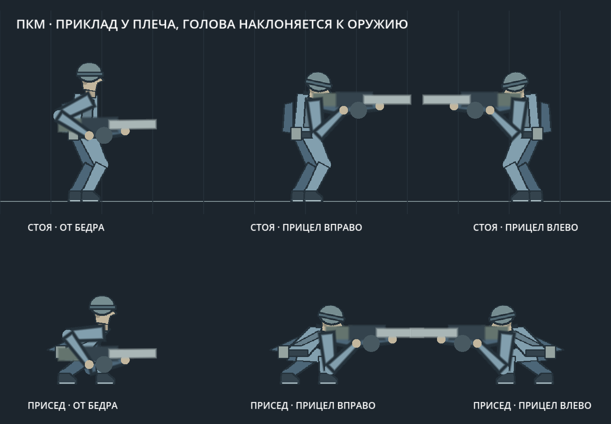
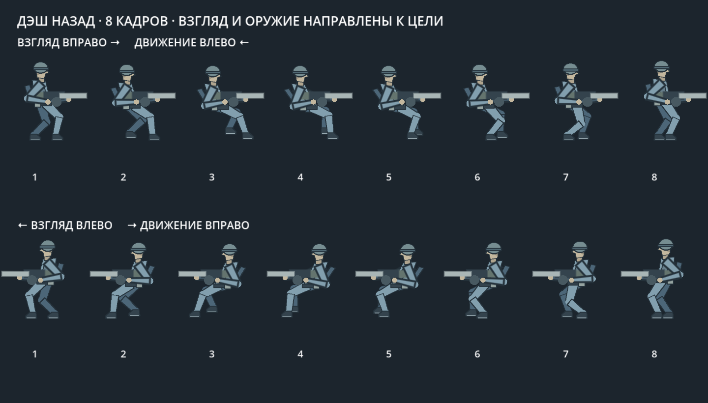

# Гибридная заглушка персонажа

Простой солдат с человеческими пропорциями, каской, ботинками, небольшим
рюкзаком и подсумком. Графика намеренно состоит из крупных цветовых пятен.
Активная сцена `scenes/main.tscn` уже использует этого персонажа.

В прологе по заданию 2026-10-17 можно выбрать Гарри или Софию Шоль:
София использует сегментные изображения, а Гарри после следующего поручения —
пробную сетку деформации на Skeleton2D и три нарисованные позы головы.
Его анимация интерполирует прежние ключевые позы и сохраняет IK рук;
тот же рисунок деформируется на физическом скелете, есть переход подъёма.
Возврат прежнего облика — F5. [Подробности](CORE_DEFORM_HARRY.md).
Исходный Sprite2D тела скрывается только при непустом `player.character_id`;
облик физических частей также следует выбранному персонажу. Полигон
при прямом запуске сохраняет прежнюю модель. При входе из меню на полигон
теперь выбирается герой/оружие: текущий Гарри либо София с рисованными
фазами на скелете. [Меню и игровые облики](CORE_CAMPAIGN.md),
[новая София только на полигоне](CORE_SOFIA_CELS.md).

Последняя София v3 получает позы из цельных рисованных кадров с собственной
анатомией; голова/корпус/ноги не подгоняются под прежнюю заглушку. Таблица ниже
описывает исходного тестового героя, не её новый набор. Хват выбранного оружия
у Гарри/Софии использует постоянные длины рук и отдельную посадку моделей.

## Исходный герой полигона: цельные запечённые кадры

| Движение | Кадры | Выбор позы |
|---|---:|---|
| Ходьба стоя | 8 | Короткий шаг без полёта, цикл — 64 игровых пикселя |
| Бег | 8 | Пройденное расстояние, полный цикл — 96 игровых пикселей |
| Спринт | 8 | Цикл — 128 пикселей; корпус сильнее наклонён, шаг шире |
| Толкание предмета | 8 | Захват по G; наклон корпуса, короткие шаги и усилие; две кисти на предмете, оружие за спиной |
| Тяга предмета | 8 | Движение назад с отклонением от груза; лицо и две руки остаются направлены к предмету |
| Подкат | 8 | Низкая сидячая поза с ногами вперёд; кадр по доле длительности, тело и оружие по зафиксированному движению |
| Прыжок | 8 | 0–3 подъём; 4–6 падение; 7 короткое сжатие при приземлении |
| Дэш назад | 8 | Взгляд к цели, перенос веса назад; отдельные кадры без разворота корпуса |
| Дэш | 8 | Доля оставшегося времени, от начала до завершения |
| Лестница | 8 | Высота относительно перекладин, цикл — 48 пикселей |
| Покой | 1 | Нейтральная стойка |
| Присед | 1 | Низкая стойка с согнутыми коленями |
| Ходьба в приседе | 8 | Пройденное расстояние, цикл — 64 пикселя; назад цикл обращается |

В обычном движении корпус и ноги не собираются из сегментов: Sprite2D переключает
готовые изображения. На каждый кадр сохранены точки обоих плеч.
В беге есть контакт, отталкивание и полёт, разные позы передней и дальней
ноги, сгибание коленей, небольшой наклон корпуса и перенос веса.
Замедление стрельбой уменьшает темп перебора кадров. Движение назад
разворачивает цикл; на лестнице отпускание W/S сохраняет позу.
Изменения F3 подхватываются сразу, без изменения длины игровой анимации
дэша относительно таймера механики. При очень коротком дэше на экране
может физически не хватить тактов для показа всех восьми исходных кадров.

PNG: `resources/core/hybrid/{walk,run,sprint,slide,jump,dash,dash_back,climb,crouch_walk}.png` — горизонтальные полосы
3112×384, каждый кадр 384×384. Покой — 384×384. Рисунок запечён в масштабе
4× и показывается в масштабе 0,25: игровая фигура высотой около 64 пикселей.
Единая опорная точка ног — (192, 320) в кадре PNG; метаданные плеч в игровых
координатах — `resources/core/hybrid/poses.gd`.

Для падения от взрыва в тех же метаданных сохраняются таз, шея, голова,
колени, лодыжки и стопы каждого кадра. Сегментные руки передают свои реальные
плечи, локти и кисти. Они задают исходную позу физического тела героя без
перехода в стойку манекена. `player_ragdoll_skin.gd` рисует на движущихся костях
ту же форму, шлем, лицо, ботинки и снаряжение; автомат закреплён вдоль спины.
После восстановления включаются обычные запечённые кадры и управление.

Воспроизводимый исходник рисунков — `tools/bake_core_hybrid.py`, нужен Pillow:

```sh
python3 tools/bake_core_hybrid.py
/Applications/Godot.app/Contents/MacOS/Godot --headless --path . --import
```

Это новый самостоятельный набор простых рисунков, прежние рисованные
персонажи, 3D-модели и старые сборки сохраняются в своих каталогах.

## Руки и оружие

`scripts/core/hybrid_body.gd` выбирает кадры и точки плеч.
`scripts/core/hybrid_arm.gd` рисует плечо, предплечье и кисть отдельно,
решая положение локтя через двухзвенную обратную кинематику.
Дальняя рука лежит за телом, ближняя — перед оружием. Обе кисти привязаны
к точкам хвата из `CoreShootingController.visual_pose()`, включая откат и
подброс. Ствол, приклад, ствольная коробка и барабан — простая заглушка
автомата. Прицеливание работает в обе стороны и по вертикали.
Удержание ПКМ поднимает автомат к плечу за 0,12 с. Для горизонтального
наведения конец приклада совпадает с опорой ближнего плеча; ствольная
коробка на 8 игровых пикселей ниже прежней позы у глаз. Голова сдвигается
вперёд на 2 px, вниз на 4 px и наклоняется на 12° к прикладу.
Пять запечённых положений головы связаны с тем же переходом ПКМ.
Отпускание возвращает нейтральную голову и оружие от бедра.
Опорная точка оружия следует плечу текущего кадра стоя, в ходьбе, беге,
прыжке и приседе. Дэш, подкат, лестница и F8 отменяют поднятую позу;
пауза замораживает переход.

`{idle,walk,run,jump,crouch,crouch_walk}_ads.png` содержат пять рядов
с теми же кадрами движения и точками плеч; меняется только рисунок
головы и шеи. Тело остаётся цельным запечённым изображением.



На лестнице оружие визуально закрепляется за спиной. Руки поочерёдно
переходят на соседнюю перекладину, другая рука сохраняет опору. Поручни
лестницы выступают на 72 пикселя над площадкой, чтобы хват был возможен
до выхода наверх. Геометрия входа и выхода с лестницы не изменилась.

Коллизия игрока, скорости, высота прыжка, таймер дэша и правила огня
сохраняются. Кадры тела выбираются до расчёта выстрела; при поднятии оружия
переносится точка вылета пули, а точность, урон и скорость пули сохраняются.
F1 показывает прежнюю границу коллизии.

F5 → «Визуал» регулирует направленный блюр тела, рук и оружия, а также
сглаживание текстуры тела. По умолчанию оба эффекта выключены для тестирования.
Все части героя объединены в CanvasGroup с порядком: дальняя рука, тело,
оружие, ближняя рука. Прицел и частицы остаются вне группы.
Подробности — [визуал героя](CORE_CHARACTER_VISUALS.md).

## Просмотр и проверка

Запуск игры — `run.command`, либо F5 в Godot. Управление прежнее:
A/D — бег, Ctrl — ходьба стоя, Shift — спринт, Alt — дэш, C — присед,
Пробел — прыжок, W/S — лестница, мышь, ЛКМ и ПКМ. F3/F4 — настройки.
`docs/core/hybrid_character.gif` — увеличенный обзор четырёх движений;
`docs/core/hybrid_gameplay.png` — персонаж в тестовой площадке.

```sh
/Applications/Godot.app/Contents/MacOS/Godot --path . -s tools/capture_core_hybrid.gd
/Applications/Godot.app/Contents/MacOS/Godot --headless --path . -s tests/core_hybrid_smoke.gd
```

20 проверок: все восемь кадров в обычном беге, полном прыжке и базовом
дэше; хват оружия в шести направлениях; работа лестницы, остановка,
обратное движение, пауза, отдача и очистка визуального состояния.
Проверяется также экспортный пакет из отдельной пустой папки: кадры и
метаданные попадают в экспорт как зависимости, старые рисунки исключены.
`tests/ads_pose_smoke.gd` содержит 30 проверок: высота относительно плеча,
переход и наклон головы, хват, разворот, все кадры бега, ходьбы и прыжка
в прицеле, присед, точка вылета, препятствие
на новой высоте ствола и отмену позы при дэше, лестнице и сбросе.

Ходьба стоя использует `walk.png`: 8 кадров, короткий шаг без фазы полёта,
полный рост 64 px и цикл на каждые 64 px пути. Отдельна от `run.png`
и `crouch_walk.png`; обе сегментные руки продолжают держать оружие.

## Дэш назад

Направление движения дэша выбирается A/D. Вне спринта взгляд остаётся направлен к курсору.
Если направления противоположны, используется отдельная полоса `dash_back.png`
из восьми кадров: корпус слегка откидывается назад, ноги переносят вес,
а сегментные руки сохраняют хват перед собой. Камера также следует за взглядом,
поэтому начало и конец отступления не меняют знак упреждения.
Прицеливание и стрельба во время дэша блокируются как прежде.



Изображение воспроизводится `tools/capture_dash_retreat.gd`; проверка механики —
`tests/dash_retreat_smoke.gd`, с реальным курсором — `tests/dash_mouse_smoke.gd`.

При активном спринте корпус разворачивается по фактическому движению,
а оружие принимает позу переноски перед ним. Бег, ходьба и присед
сохраняют направление курсора; обратный цикл кадров учитывает скорость
движения задом из отдельной вкладки F3. Камера сохраняет независимый
взгляд курсора, чтобы этот временный разворот не менял знак упреждения.

Дэш из спринта сохраняет разворот тела и оружия по направлению самого дэша
на всё действие, включая отпускание Shift. Выбирается `dash.png`; для движения
влево тело зеркалится вместе с плечевыми опорами и хватом оружия. После дэша
возвращается актуальная поза спринта или взгляд к курсору. Камера сохраняет
независимый взгляд курсора. Сравнение восьми кадров — `core/sprint_dash_frames.png`,
регрессионная проверка переходов — `tests/sprint_dash_smoke.gd`.
