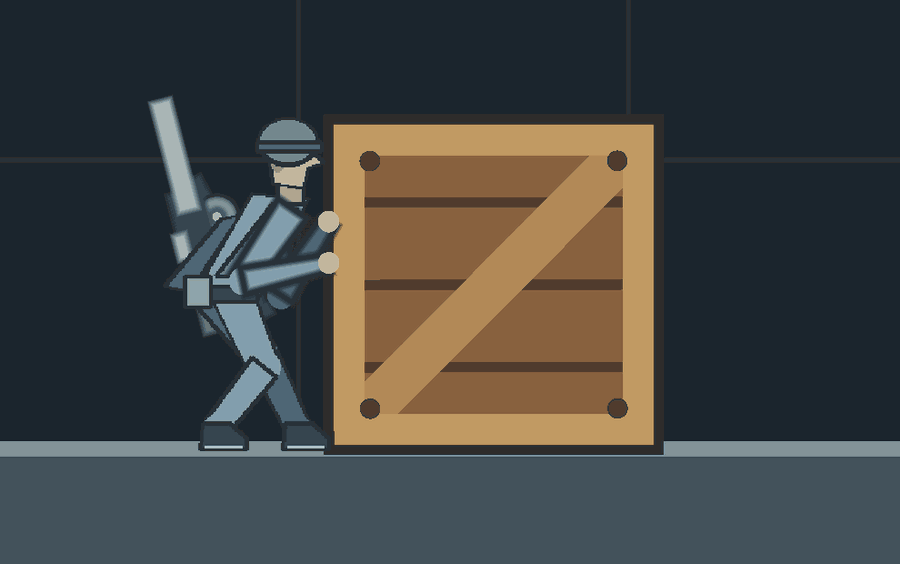
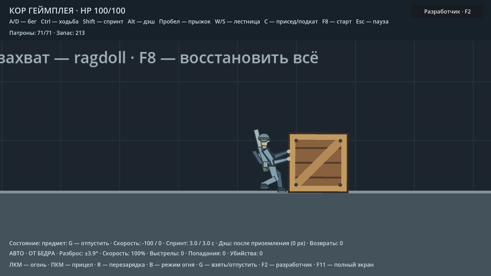
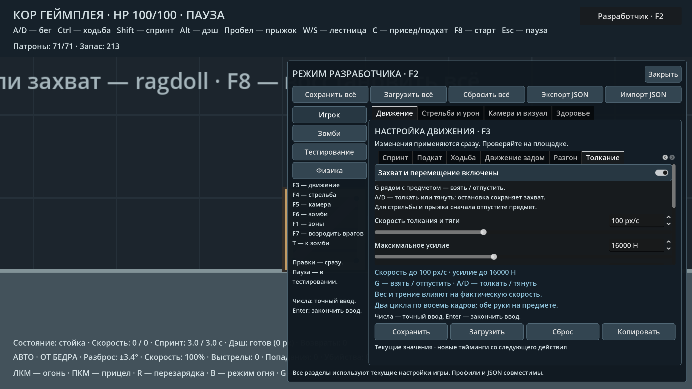

# Захват, толкание и тяга физических предметов

Подойдите вплотную к ящику или манекену слева от старта и нажмите **G**.
Персонаж разворачивается к предмету, убирает автомат за спину и берётся двумя
руками. **A/D** в сторону предмета толкает его, в обратную сторону — тянет.
Повторное **G** освобождает руки. Остановка движения сохраняет захват.

Без G персонаж не сдвигает предмет обычным столкновением, спринтом, дэшем
или подкатом. Гравитация, вращение, внешние импульсы и попадания пуль продолжают
работать: взаимодействие не замораживает всю физику объекта.

У толкания и тяги отдельные циклы тела по **8 кадров**. При тяге корпус
отклонён от груза, лицо остаётся направлено к нему. Две сегментные руки
привязаны к поверхности текущего коллайдера; оружие находится за телом.
Шаги учитывают фактическое перемещение и усилие. На остановке герой сохраняет
устойчивую позу без переступания ногами. Взгляд камеры продолжает определяться
курсором.

Пока предмет в руках, прыжок, дэш, приседание, спринт, стрельба, прицеливание
и перезарядка заблокированы. Для них сначала отпустите предмет на G.
Во время прыжка, перезарядки, приседа, подката и дэша начать захват нельзя.
Ввод G при редактировании настроек и на паузе не меняет захват. Короткое
нажатие между двумя физическими кадрами не теряется; удержание кнопки
не переключает состояние многократно.

Смерть, принудительное отбрасывание, F8, удаление объекта, отключение механики
или физики манекена освобождают руки. Падение и сильное внешнее перемещение
предмета также разрывают недостижимый захват. Esc останавливает физику и анимацию.

## Настройки

**F3 → «Толкание»** или **F2 → «Игрок → Движение → Толкание»**.
Сохранены восемь ползунков, точный числовой ввод, тумблер и ключи старых профилей.

| Параметр | По умолчанию | Диапазон | Назначение |
|---|---:|---:|---|
| Скорость толкания и тяги | 100 px/с | 20–240 | Максимальная скорость игрока с предметом |
| Максимальное усилие | 16000 | 0–40000 | Предел силы; 0 оставляет захват без усилия |
| Сила выхода на скорость | 250× | 10–500 | Реакция на разницу текущей и целевой скорости |
| Задержка усилия после захвата | 0,08 с | 0–0,5 | Пауза после G перед приложением силы |
| Свободный ход захвата | 4 px | 0–12 | Допуск расстояния при тяге; также допуск близкого подхода |
| Темп шагов с предметом | 1× | 0,25–2,5 | Темп шагов и движений усилия |
| Высота захвата руками | 40 px | 20–54 | Высота середины захвата относительно стоп |
| Разнос кистей по высоте | 8 px | 0–20 | Разница высот передней и задней руки |

Масса, трение, вращение и препятствия ограничивают фактическую скорость.
При тяге тяжёлый или застрявший предмет удерживает игрока; стена позади
игрока останавливает движение, не позволяя протянуть ящик через персонажа.
Координаты и скорость предмета не назначаются: применяется ограниченный
импульс `RigidBody2D` в точке захвата с учётом вращения.

Захват поддерживает динамические `RigidBody2D`. Дополнительный контракт
`can_grab()` / `begin_grab()` позволяет предметам управлять доступностью.
У манекена G активирует все физические сегменты и их суставы; отключённая
в панели симуляция блокирует захват. Динамические имена коллайдеров подходят.

Выключение механики освобождает руки и сохраняет настройки. Повторное
включение требует нового G. Значения сохраняются в CFG движения и общем JSON;
старые файлы получают значения по умолчанию. F8 очищает старые контакты при
сбросе ящика, чтобы перенос игрока через него не создавал ложный импульс.

## Проверка

`tests/pushing_smoke.gd`: **79 проверок** — захват и повторное G, обе стороны толкания и тяги,
полные восьмикадровые циклы и обе кисти, отсутствие сдвига без G при четырёх
типах движения, остановка, короткое/долгое нажатие, редактирование настроек,
стена позади игрока, манекен, слои оружия, блокировка занятых рук, масса,
сила, скорость, анимация, переключатель, смерть, удаление предмета и CFG/JSON.
`tests/physics_crate_smoke.gd`: **22 проверки** физики ящика, падения, толкания,
прыжка сверху, попаданий, импульсов, паузы и F8.

Кадры — `resources/core/hybrid/push.png` и `pull.png`; плечи — `poses.gd`.
Перезапечь только тягу: `python3 tools/bake_core_hybrid.py --only pull`.
`tools/capture_pushing.gd` создаёт снимки толкания, тяги и настроек,
а также последовательность реальных игровых кадров для демонстрации.

