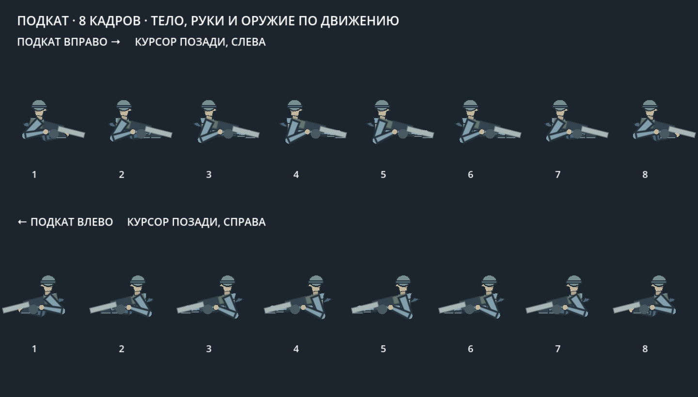
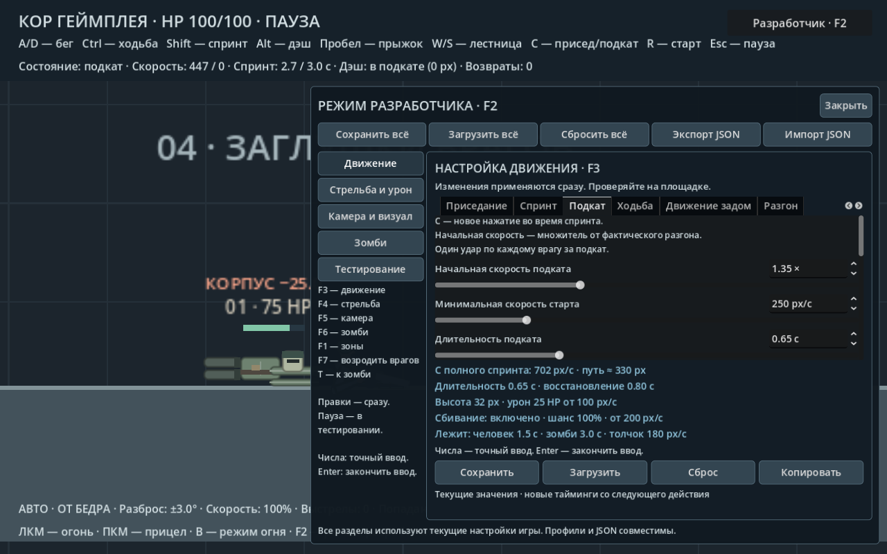
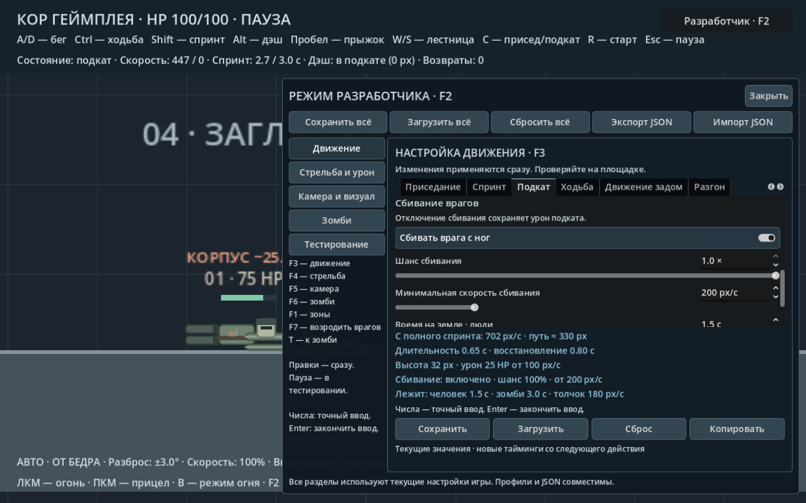

# Подкат после спринта

Удерживайте Shift с A/D, наберите скорость и **нажмите C**.
Нужно новое нажатие приседания; удержание C до начала спринта даёт
обычный присед. Без спринта, в воздухе, на лестнице, при прицеливании,
огне, отталкивании или во время восстановления подкат не запускается.

## Движение

Начальный импульс берётся от фактической скорости разгона по поверхности.
Подкат сохраняет направление до завершения и постепенно тормозит.
Отпускание приседания или противоположное направление не прерывают его.
Подкат следует уклону, проходит под низкими потолками и блокируется стенами.
Прыжок прерывает его; выход за край возвращает обычное падение.
Дэш, лестница и огонь во время подката недоступны. Подкат не даёт
неуязвимости. Запас спринта в этот момент не восстанавливается.

По окончании удержанное приседание оставляет героя в обычном приседе,
отпущенное — поднимает. Под низким потолком низкая коллизия сохраняется
до появления свободного места. Пауза замораживает действие и таймеры,
F8 очищает состояние подката. Есть восемь запечённых кадров тела,
сегментные руки продолжают держать оружие.

На всём протяжении подката тело, оружие и обе руки ориентированы по
зафиксированному направлению движения, в том числе при курсоре позади
героя, отпускании Shift или обратном вводе A/D. Оружие сохраняет позу
переноски; руки держатся за соответствующие точки хвата и не выворачиваются
к прицелу. После окончания или отмены подката возвращается обычное
прицеливание. Прицел и направление упреждения камеры остаются независимыми.

`tests/slide_facing_smoke.gd`: **84 проверки** всех восьми кадров и обеих
сторон, курсора спереди/сзади и его перемещения в ходе подката, удержания
и отпускания Shift, обратного ввода, высоты коллизии 28/32/42 px,
точек хвата, длины сегментов рук, камеры, дальности и возврата прицеливания.
`tools/capture_slide_facing.gd` создаёт `docs/core/slide_facing_frames.png`.

## Контакт с врагом

За один подкат каждый враг получает **один** прямой удар в здоровье,
без множителей зонального урона и без отрыва конечностей. Порог скорости
урона и порог сбивания независимы. Оба проверяются при столкновении.
Попадание вызывает существующие звук и индикатор удара; смертельное —
эффект убийства. Настройки сбивания не отключают урон.

При успешном сбивании враг получает горизонтальный импульс, меняет позу
и коллизию на лежачую, временно не патрулирует, не преследует и не атакует.
Подкат продолжает движение сквозь уже сбитые цели. Стоящий враг, которого
не удалось сбить, останавливает подкат. В плотной группе каждая цель
обрабатывается отдельно. Безопасные исключения столкновения очищаются
после завершения подката и выхода из лежащих тел.

Враг встаёт после таймера, если пространство свободно. Потолок или игрок
над телом задерживают вставание. Потерянные конечности и здоровье не
восстанавливаются. У зомби без ноги после временного сбивания сохраняются
ползание и все прежние ограничения. Временное сбивание отменяет замах
зомби и исключает его сброс игрока на время падения.

## F3 → «Подкат»

| Настройка | По умолчанию | Диапазон |
|---|---:|---:|
| Начальная скорость, множитель от разгона | 1,35× | 0,5–3× |
| Минимальная скорость старта | 250 px/с | 50–1000 |
| Длительность | 0,65 с | 0,1–2 |
| Торможение | 600 px/с² | 0–3000 |
| Восстановление от старта | 0,8 с | 0,1–3 |
| Высота коллизии | 32 px | 28–42 |
| Урон | 25 HP | 0–100 |
| Минимальная скорость урона | 100 px/с | 0–1000 |

При полном базовом спринте 520 px/с начальная скорость — 702 px/с,
расчётная дальность на ровном полу — около 330 px. Сильное торможение
может остановить подкат раньше таймера. Восстановление автоматически
не короче длительности. Скорость и тайминги берутся при старте;
торможение и безопасное изменение высоты работают сразу.

## F3 → «Подкат» → «Сбивание врагов»

| Настройка | По умолчанию | Диапазон |
|---|---:|---:|
| Сбивать врага с ног | Включено | Переключатель |
| Шанс сбивания | 1 = 100% | 0–1 |
| Минимальная скорость сбивания | 200 px/с | 0–1000 |
| Время на земле · люди | 1,5 с | 0,2–5 |
| Время на земле · зомби | 3 с | 0,2–5 |
| Сила отбрасывания | 180 px/с | 0–600 |

Шанс 0 или выключенный переключатель отключают сбивание, сохраняя урон.
Порог скорости позволяет сбивать только быстрым подкатом. Параметры
применяются при столкновении; уже начавшееся падение сохраняет свой таймер.
Сохраняются все значения и переключатель — через профиль F3 или общий
JSON F3–F6. Время выбирается при ударе по типу противника. Оба ползунка
независимы: по умолчанию зомби лежит дольше, но значения можно менять отдельно.
Когда таймер истёк, враг встаёт только при свободном месте над телом; потерянные
конечности не восстанавливаются. Старый ключ `slide_knockdown_duration` сохраняет
настроенное время для людей. Новый `slide_zombie_knockdown_duration` по умолчанию
равен 3 с. Старые файлы без параметров подката получают базовые значения.

Проверки: `tests/slide_smoke.gd`, `tests/slide_knockdown_times_smoke.gd`
и `tests/settings_file_smoke.gd`.
Исходник кадров — `tools/bake_core_hybrid.py`; превью и базовый JSON —
`tools/capture_slide.gd`.
