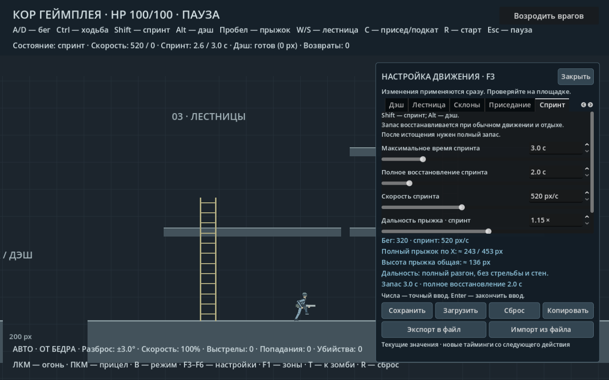

# Бег и спринт

**A/D или стрелки** — бег по умолчанию; **Ctrl** при движении — медленная ходьба стоя,
**удерживать Shift** — спринт. Отдельной клавиши обычного бега нет.
Дэш перенесён на **Alt / Option**. Приседание — C. Настройки ходьбы: [отдельная вкладка F3](CORE_STANDING_WALK.md).

Обычная скорость — 320 px/с, спринт — 520 px/с. Оба режима используют
общие разгон, торможение, управление в воздухе и множители склонов.
Спринт требует направления движения. При активном спринте герой поворачивается
лицом по движению и несёт оружие перед собой, даже если курсор остался сзади.
При выходе из спринта взгляд и оружие возвращаются к курсору; обратное движение
замедляется по настройкам F3 → «Движение задом». При удержании Ctrl, приседании, прицеливании
или удержании кнопки огня он отключается; замедление стрельбой берётся
от обычной скорости. После отпускания огня Shift снова включает спринт.
В одиночном режиме удержание уже сработавшего спуска также исключает спринт.

Запас спринта ограничен: по умолчанию **3 секунды**, полное восстановление —
**2 секунды**. При обычном движении, остановке, приседе и на лестнице запас
пополняется постепенно. Раннее отпускание Shift сохраняет потраченную долю;
быстрые повторные нажатия не обнуляют расход. После полного истощения спринт
заблокирован до полного восстановления. Если Shift всё ещё удерживается,
после восстановления спринт возобновится автоматически.
HUD показывает оставшийся запас либо время восстановления. На паузе оба
таймера заморожены; возрождение по R возвращает полный запас.

Новое нажатие приседания C после разгона запускает подкат. Его
движение, урон и сбивание настраиваются отдельно: `docs/CORE_SLIDE.md`.
Во время подката запас спринта не восстанавливается.

Дэш, начатый из активного спринта, сохраняет корпус и оружие по направлению
рывка во всех восьми кадрах. При движении влево кадры зеркалятся. Положение
курсора и отпускание Shift во время дэша не разворачивают анимацию; по завершении
герой продолжает спринт или возвращается к направлению курсора. Упреждение камеры
остаётся привязано к курсору. Проверка — `tests/sprint_dash_smoke.gd`,
сравнение сторон — `docs/core/sprint_dash_frames.png`.

## Прыжок

Горизонтальная скорость при отталкивании умножается на значение выбранного
режима. Полный разгон даёт длинный прыжок, прыжок с места — короткий.
Высота и длительность вертикальной дуги общие. Короткое нажатие Пробела
по-прежнему уменьшает высоту и время полёта.

В воздухе сохраняется скорость выбранного при отталкивании режима:
отпускание Shift не обрывает спринтерский прыжок, нажатие Shift в воздухе
не превращает обычный прыжок в спринтерский. A/D сохраняют управление
и торможение в воздухе; стрельба и прицел применяют своё замедление.
Изменённые скорость режима и множитель применяются при следующем отталкивании.
Прыжок с лестницы использует множитель обычного движения.
Спринтерский прыжок расходует запас в воздухе. Если запас закончился в полёте,
набранная скорость прыжка сохраняется до приземления; восстановления
в воздухе нет. После приземления герой переходит к обычному движению.

## Настройки F3

| Вкладка | Настройка | По умолчанию | Диапазон |
|---|---|---:|---:|
| Бег | Скорость бега | 320 px/с | 100–750 |
| Бег | Дальность прыжка · бег | 1× | 0,25–2 |
| Спринт | Максимальное время спринта | 3 с | 0,2–15 |
| Спринт | Полное восстановление спринта | 2 с | 0,2–15 |
| Спринт | Скорость спринта | 520 px/с | 100–1200 |
| Спринт | Дальность прыжка · спринт | 1,15× | 0,25–2 |
| Спринт | Шум шагов в спринте | 1,5× | 0–3 |

Скорость спринта автоматически поднимается до обычной, если обычная
оказалась выше. Панель показывает приблизительную дальность полного
прыжка при полном разгоне на ровном полу, без стен и стрельбы.
Расчёт — `скорость × множитель × 2 × сила прыжка / гравитация`:
примерно 243 / 453 px. При 60 физических тактах фактически получается
около 256 / 477 px из-за дискретного шага и контакта с полом.

Профиль сохраняется общей кнопкой F3, новые значения также входят в JSON
экспорта F3–F6. Старый ключ `run_speed` остаётся скоростью обычного движения;
старые профили получают базовые параметры спринта и дальности прыжков.
Изменение длительности или восстановления применяется сразу к скорости
расхода/пополнения, сохраняя текущую долю запаса. Импорт и сброс настроек
также не выдают бесплатный полный запас.

Спринт имеет восемь запечённых кадров тела и сегментные руки с оружием.
Цикл привязан к расстоянию, а не к времени: 128 px на цикл, при движении
назад кадры идут в обратном порядке. Исходник — `tools/bake_core_hybrid.py`.

Проверка: `tests/sprint_smoke.gd`, `tests/sprint_limit_smoke.gd`; совместимость с импортом —
`tests/settings_file_smoke.gd`. Скриншот и базовый JSON воспроизводятся
через `tools/capture_sprint.gd`.
